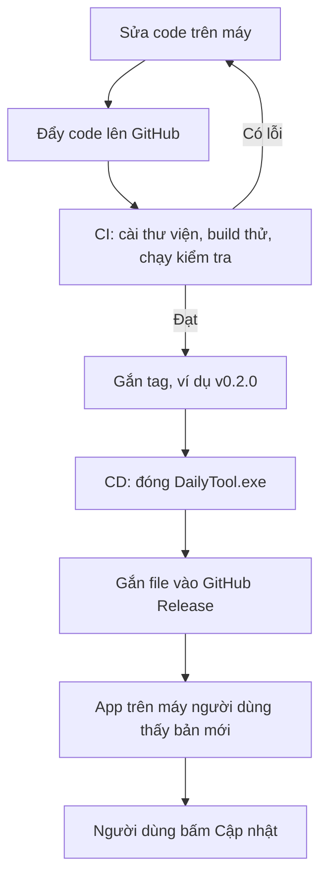

# DailyTool

Ứng dụng xuất ngày nghỉ bác sĩ từ file chấm công tháng. Bản dùng hằng ngày là `dist/DailyTool.exe`.

## Quy trình CI/CD

Code mới được kiểm tra trước. File phát hành chỉ tạo khi gắn tag.



**CI** là đoạn từ lúc đẩy code đến lúc kiểm tra xong. Máy làm việc này mỗi lần có code mới. Có lỗi thì sửa lại, chưa có file phát hành.

**CD** bắt đầu khi gắn tag. Workflow `.github/workflows/release.yml` đóng `DailyTool.exe` và đưa lên GitHub Release. App đang cài đọc Release đó và thay file cũ. Danh mục mã bác sĩ nằm ngoài file exe nên vẫn còn sau khi cập nhật.

Hiện kho đã có nhánh CD. Nhánh CI, tức kiểm tra tự động trên mỗi lần đẩy code, chưa có.

## Phát hành một bản mới

1. Điền kho GitHub vào `GITHUB_REPO` trong `dailytool/__init__.py`, dạng `chu-so-huu/ten-kho`, rồi mới đóng gói bản đưa cho người dùng.
2. Tăng `__version__` cho trùng tag. Tag `v0.2.0` thì phiên bản trong mã là `0.2.0`.
3. Đẩy tag `v0.2.0` lên GitHub.

Workflow chỉ chạy khi tag bắt đầu bằng `v`. File đính kèm trên Release phải đúng tên `DailyTool.exe`.

Kho công khai thì người dùng không cần đăng nhập. Kho riêng tư thì mỗi máy đặt một dòng token trong `%APPDATA%\DailyTool\github.token`.

## Build trên Windows

Đóng DailyTool nếu đang mở, rồi chạy trong thư mục dự án:

```powershell
python -m pip install -r requirements.txt pyinstaller
python -m PyInstaller --noconfirm --clean DailyTool.spec
```

File tạo ra: `dist\DailyTool.exe`.

`build_windows.sh` dùng khi build trên macOS hoặc Linux qua Docker. `DailyTool.command` là cách mở app trên Mac.

Danh mục mã khi chạy từ mã nguồn nằm ở `data\ma_bac_si.json`. Bản exe đọc `%APPDATA%\DailyTool\ma_bac_si.json`.
